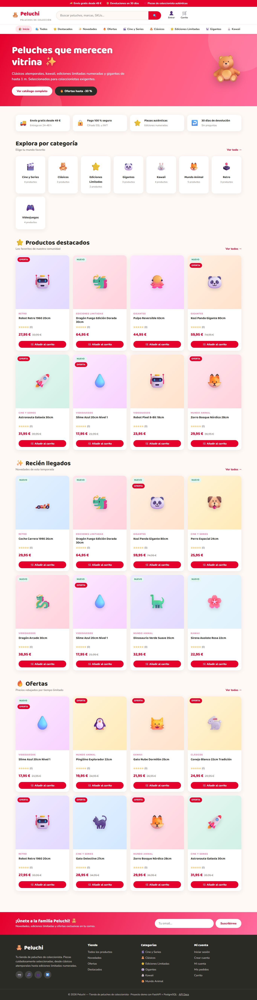
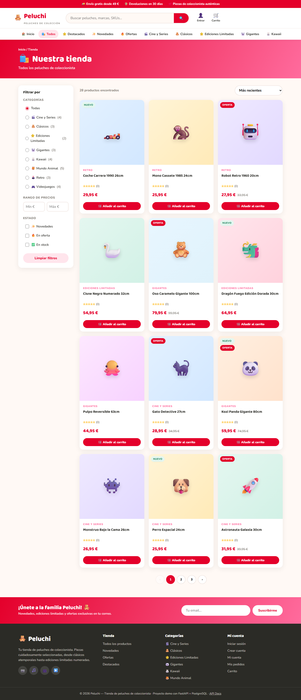
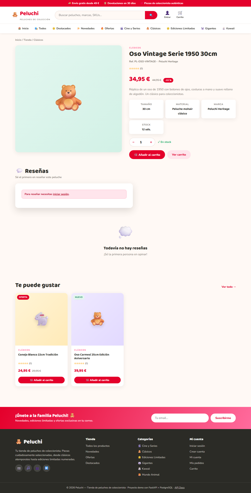
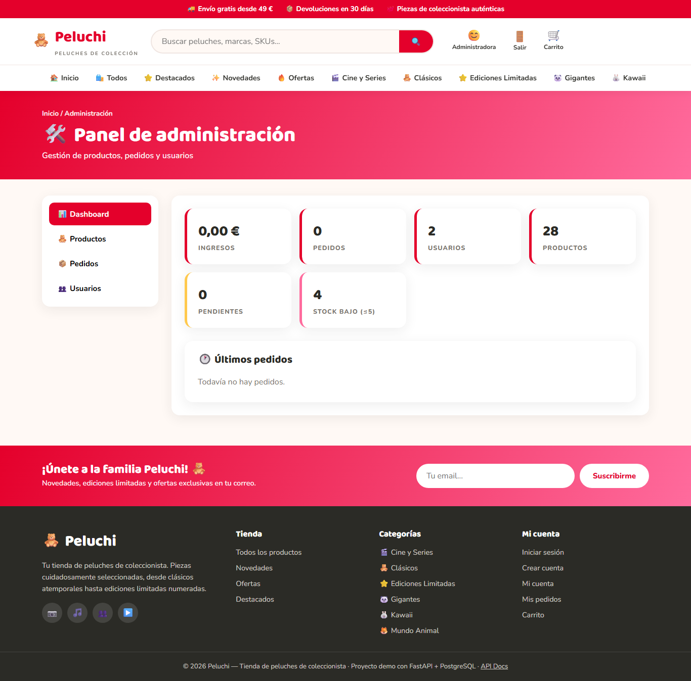

# 🧸 Peluchi — API REST de tienda de peluches de coleccionista

Proyecto completo: **API REST con OAuth2 + JWT (FastAPI · PostgreSQL)** y **frontend web**
(HTML/CSS/JS puro) inspirado en el diseño de [miniso.es](https://www.miniso.es/) y
[amordepeluche.com](https://amordepeluche.com/es/).

Enlace para entrar a la página publicada en Render: https://peluchi-api.onrender.com


---

## ✨ Características

### Backend (FastAPI + PostgreSQL)
- **Autenticación JWT** (access token 30 min + refresh token 7 días con rotación)
- **OAuth2 con GitHub** (flujo Authorization Code + state firmado contra CSRF)
- **OAuth2 clásico** con email/contraseña (`OAuth2PasswordRequestForm`)
- Catálogo con búsqueda, filtros, ordenación y paginación
- Carrito, checkout con control de stock y pedidos
- Reseñas (1 por usuario), perfil de usuario y cambio de contraseña
- **Panel de administración**: métricas, CRUD de productos, gestión de pedidos y usuarios
- Seed idempotente: 8 categorías, 28 peluches, 2 usuarios de ejemplo
- Documentación interactiva en `/docs` (OpenAPI)

### Frontend (sin frameworks ni build)
- 10 páginas: inicio, tienda, ficha de producto, login, registro, carrito, checkout,
  pedidos, cuenta y administración
- Diseño responsive con tipografías Baloo 2 + Nunito, paleta roja Miniso y toques pastel
- Cliente API con **auto-refresh de tokens** (reintenta automáticamente al recibir 401)
- Tarjetas de producto con emoji/gradiente (sin imágenes externas), toasts y estados vacíos

---

## 📁 Estructura

```
peluches-api/
├── app/
│   ├── main.py            # App FastAPI, CORS, routers y frontend estático
│   ├── config.py          # Settings (.env) con pydantic-settings
│   ├── database.py        # Engine + sesión SQLAlchemy (psycopg3)
│   ├── models.py          # ORM: User, Category, Product, Review, CartItem, Order...
│   ├── schemas.py         # Esquemas Pydantic de entrada/salida
│   ├── security.py        # bcrypt + creación/validación de JWT
│   ├── deps.py            # get_current_user / require_admin
│   ├── seed.py            # Datos iniciales (idempotente)
│   └── routers/
│       ├── auth.py        # register, login, refresh, /me, GitHub OAuth
│       ├── products.py    # catálogo, filtros, reseñas
│       ├── cart.py        # carrito
│       ├── orders.py      # checkout y pedidos
│       ├── users.py       # perfil, contraseña, estadísticas
│       └── admin.py       # métricas, CRUD, pedidos, usuarios
├── frontend/
│   ├── index.html  tienda.html  producto.html  login.html  registro.html
│   ├── carrito.html  checkout.html  pedidos.html  cuenta.html  admin.html
│   ├── css/styles.css
│   └── js/  api.js (cliente JWT)  ui.js (componentes)  + un módulo por página
├── tests/test_api.py      # 16 tests pytest (usa SQLite temporal)
├── scripts/
│   ├── smoke_test.py      # 51 comprobaciones contra el servidor levantado
│   ├── ui_test.py         # 34 tests E2E de navegador con Playwright
│   └── list_routes.py
├── .env / .env.example
└── requirements.txt
```

---

## 🚀 Puesta en marcha

### 1. Requisitos
- Python 3.11+ (probado en 3.14)
- PostgreSQL 14+

### 2. Base de datos
```powershell
# Crear usuario y base de datos (como superuser de PostgreSQL)
psql -U postgres -c "CREATE ROLE peluchi LOGIN PASSWORD 'PELUCHI_DEV_PASS';"
psql -U postgres -c "CREATE DATABASE peluchi_db OWNER peluchi;"
```

### 3. Dependencias y configuración
```powershell
cd C:\Users\Corai\peluches-api
pip install -r requirements.txt
copy .env.example .env      # y ajusta SECRET_KEY y DATABASE_URL
```

### 4. Arrancar
```powershell
python -m uvicorn app.main:app --reload
```
La primera vez se crean las tablas y se cargan los datos de ejemplo automáticamente.

| URL | Contenido |
|---|---|
| http://localhost:8000/ | Tienda (frontend) |
| http://localhost:8000/docs | Documentación OpenAPI interactiva |
| http://localhost:8000/api/health | Estado de la API |

---

## ☁️ Despliegue en Render

El repositorio incluye un **Blueprint** (`render.yaml`) que crea la base de datos
y el servicio web con prácticamente un solo clic.

### Pasos

1. Entra en <https://dashboard.render.com> y crea una cuenta (gratis, sin tarjeta).
2. En el dashboard pulsa **New → Blueprint** y conecta tu cuenta de GitHub.
3. Selecciona el repositorio `CoraimaM/Peluchi` y pulsa **Apply**.
4. Render te pedirá el valor de **`ADMIN_PASSWORD`**: escribe la contraseña que
   quieras para el administrador y **guárdala** (déjalo en blanco para usar
   `admin1234`, la documentada abajo).
5. Espera a que el despliegue termine (1-3 min) y abre la URL asignada:
   `https://peluchi-api.onrender.com`

| URL | Contenido |
|---|---|
| `https://peluchi-api.onrender.com/` | Tienda (frontend) |
| `https://peluchi-api.onrender.com/docs` | Documentación OpenAPI |
| `https://peluchi-api.onrender.com/api/health` | Estado de la API |

> **La primera petición tarda ~1 minuto**: el servicio gratuito se duerme a los
> 15 min sin tráfico y se despierra solo.

### Configuración que hace el Blueprint

| Variable | Origen |
|---|---|
| `DATABASE_URL` | inyectada desde la base de datos `peluchi-db` |
| `SECRET_KEY` | generada aleatoriamente por Render |
| `ADMIN_EMAIL` / `ADMIN_PASSWORD` | tú la eliges al sincronizar |
| `FRONTEND_URL`, `BACKEND_URL`, `CORS_ORIGINS` | derivadas automáticamente de `RENDER_EXTERNAL_URL` |

No hace falta tocar nada más: `app/config.py` convierte la URL de Render
(`postgres://…`) al driver `psycopg3` y detecta la URL pública en la que corre.

### Limitaciones del plan gratuito

- **La base de datos caduca a los 30 días** desde su creación. Render te avisa
  por correo; después tienes 14 días de gracia para subirla a plan de pago.
- El servicio se duerme a los 15 min de inactividad (~1 minuto para despertar).
- 750 horas de instancia al mes (suficiente para un servicio siempre activo).

### Auto-despliegue

`autoDeploy: true`: cada `git push` a `main` vuelve a desplegar automáticamente.

---

## 🔑 Credenciales de prueba

| Rol | Email | Contraseña |
|---|---|---|
| Administrador | `admin@peluchi.es` | `admin1234` |
| Cliente | `cliente@peluchi.es` | `cliente123` |

---

## 🐙 Configurar el login con GitHub (OAuth2)

1. Crea una app en <https://github.com/settings/developers>
   - **Authorization callback URL**: `http://localhost:8000/api/auth/github/callback`
2. Copia el *Client ID* y genera un *Client Secret* en `.env`:
   ```env
   GITHUB_CLIENT_ID=Iv1.xxxxxxxxxxxx
   GITHUB_CLIENT_SECRET=xxxxxxxxxxxxxxxxxxxxxxxx
   ```
3. Reinicia el servidor. El botón «Continuar con GitHub» se activará solo.

> Sin configurar, la API responde `400` en `/api/auth/github/login` y el botón aparece
> deshabilitado en el frontend — el resto de la tienda funciona con normalidad.

---

## 🔐 Seguridad implementada

- Contraseñas con **bcrypt** (nunca en claro)
- JWT **HS256** firmados con `SECRET_KEY`; access + refresh con tipos separados
  (un refresh token no sirve como access token)
- Refresh token **rotado** en cada uso
- OAuth GitHub con `state` aleatorio validado por **cookie firmada** (CSRF)
- Validación Pydantic de todos los payloads, rol `admin` protegido por dependencia
- CORS restringido a los orígenes de `.env`
- Los tokens viajan en el *fragmento* `#` del callback (no llegan al servidor)

---

## 📡 Endpoints principales

| Método | Ruta | Auth | Descripción |
|---|---|---|---|
| POST | `/api/auth/register` | – | Registro (devuelve tokens) |
| POST | `/api/auth/login` | – | Login email/contraseña → JWT |
| POST | `/api/auth/refresh` | – | Renueva access + refresh |
| GET | `/api/auth/github/login` | – | Redirige a GitHub |
| GET | `/api/auth/github/callback` | – | Callback OAuth |
| GET | `/api/categories` | – | Categorías con nº de productos |
| GET | `/api/products` | – | Listado: `q`, `category`, `min_price`, `max_price`, `featured`, `is_new`, `on_sale`, `sort`, `page` |
| GET | `/api/products/{slug}` | – | Detalle |
| GET/POST | `/api/products/{slug}/reviews` | – / ✓ | Reseñas |
| GET/POST | `/api/cart` | ✓ | Ver / añadir |
| PUT/DELETE | `/api/cart/{id}` | ✓ | Modificar / quitar |
| POST | `/api/orders` | ✓ | Checkout (descuenta stock) |
| GET | `/api/orders` | ✓ | Mis pedidos |
| GET/PUT | `/api/users/me` | ✓ | Perfil |
| PUT | `/api/users/me/password` | ✓ | Cambiar contraseña |
| GET | `/api/admin/stats` | admin | Métricas |
| GET/POST/PUT/DELETE | `/api/admin/products` | admin | CRUD productos |
| GET/PATCH | `/api/admin/orders[/{id}]` | admin | Estado de pedidos |
| GET/PATCH | `/api/admin/users[/{id}]` | admin | Roles y bajas |

---

## 🧪 Tests

```powershell
# 1) Tests unitarios de API (SQLite temporal, no toca PostgreSQL)
python -m pytest tests/ -v

# 2) Test de humo contra el servidor levantado (51 comprobaciones)
python scripts/smoke_test.py

# 3) Tests E2E de navegador (requiere: pip install playwright && playwright install chromium)
python scripts/ui_test.py
```

---

## 🖼️ Capturas

| Inicio | Tienda |
|---|---|
|  |  |

| Ficha de producto | Panel admin |
|---|---|
|  |  |

Hay 8 capturas en total (incluida versión móvil) generadas con `python scripts/screenshots.py`.

---

## 🗄️ Reiniciar la base de datos

```powershell
psql -U postgres -d peluchi_db -c "DROP SCHEMA public CASCADE; CREATE SCHEMA public;"
python -m app.seed     # o reinicia el servidor: el seed corre solo
```

---

## 🛠️ Stack técnico

| Capa | Tecnología |
|---|---|
| Framework | FastAPI 0.143 + Uvicorn |
| ORM / BD | SQLAlchemy 2.0 + PostgreSQL 17 (driver psycopg3) |
| Auth | JWT (python-jose) · bcrypt · OAuth2 GitHub (httpx) |
| Frontend | HTML5 + CSS3 + JavaScript ES Modules (sin build) |
| Tests | pytest · Playwright (E2E) |
